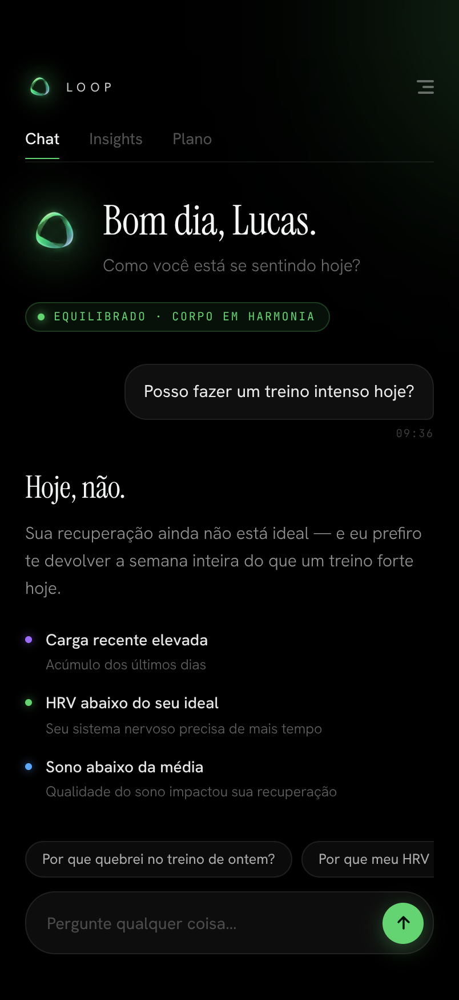
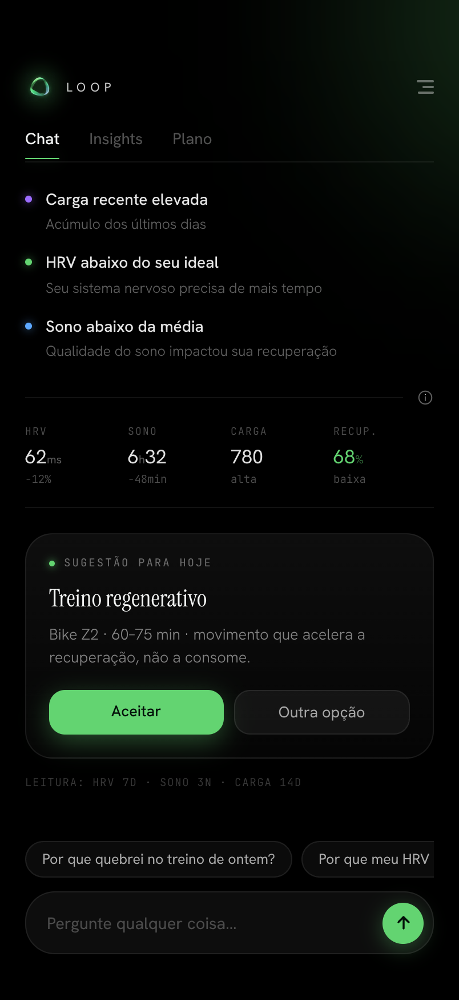
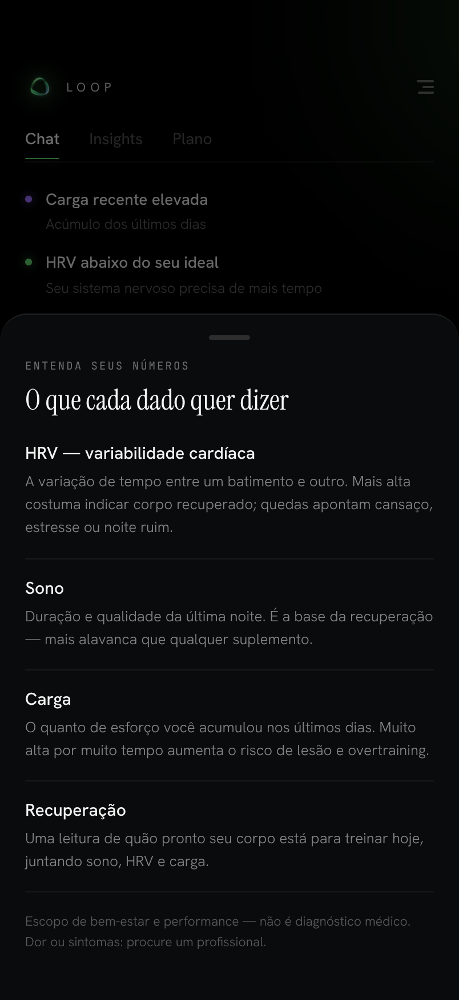
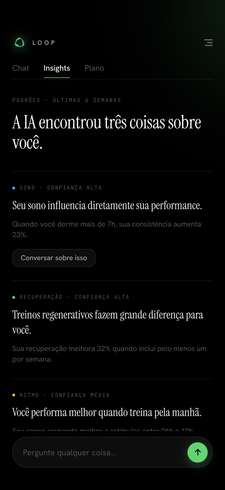
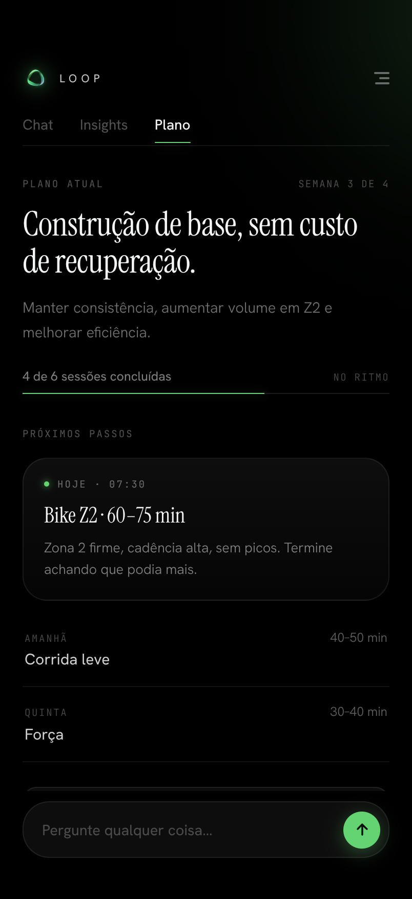

# Copiloto do Corpo — decisão de treino por IA (Pulse Loop)

> **Estágio:** protótipo avançado · **~35% do MVP beta** · ⚠️ **ainda NÃO está pronto para produção/publicação.**

Coach de IA para atletas de endurance/triatlo (**Brasil-first**) que unifica os dados do wearable (Garmin), calcula **carga e prontidão**, e entrega **uma decisão por dia** — treinar ou recuperar — de forma **segura**, convivendo com a assessoria do atleta. O chat é o produto; os números são o rodapé da decisão. Interface **Pulse Loop**: dark premium, com o **orb** animado como presença da IA.

---

## 📱 As telas (Pulse Loop)

<p align="center">
  
  
  
  
  
</p>

<p align="center"><sub>Chat (decisão do dia) · métricas + sugestão · glossário dos números (o “i”) · Insights · Plano. Interface real do app, dados de exemplo.</sub></p>


## 📊 Quanto está pronto (medição honesta)

| Área | Estado | % |
|---|---|---|
| Motor de carga / prontidão / decisão (TypeScript, testado) | Funcional, validado em Node | ~85% |
| App mobile — UI **Pulse Loop** (Chat / Insights / Plano, orb, fontes) | Alta fidelidade, navegável | ~75% |
| Parser do plano da assessoria (heurístico + LLM) | Esqueleto + validação | ~50% |
| Integração de dados reais (Health Connect no aparelho) | Mapeamento + stubs; não validado ponta-a-ponta no device | ~35% |
| Backend (rotas `today`/`plan`/`webhooks`, Prisma, demo) | Esqueleto rodável, muitos TODOs | ~25% |
| Coach conversacional por IA (respostas reais) | Hoje **mockado**; precisa LLM/servidor | ~15% |
| Consentimento / LGPD / autenticação | Desenhado e documentado | ~10% |
| Garmin Developer Program (OAuth + webhooks) | Não iniciado (Health Connect primeiro) | ~5% |
| Push (FCM) + tarefa matinal | Documentado | ~5% |
| Publicação na Play Store | Não iniciado | 0% |
| **Global — MVP beta** | **Protótipo avançado** | **≈ 35%** |

> O **cérebro** (motor) e o **rosto** (app) estão adiantados. O que falta é o **meio de campo**: dados reais no aparelho ponta-a-ponta, backend com IA server-side, auth/consentimento e publicação.

---

## 🧠 O que é (tese)
O mercado é ótimo em **capturar e exibir** dados e péssimo em **decidir pelo usuário**. O Copiloto é a **camada de decisão**: lê o corpo, lembra do histórico e diz **o que fazer hoje** — com segurança acima de performance. Público #1: corredor(a)/triatleta amador(a) brasileiro(a) com prova marcada e medo de lesão.

## 🗂 Estrutura do monorepo
- **`packages/shared/`** — motor em **TypeScript puro e testável**:
  `load.ts` (TRIMP de Banister / TSS, **CTL/ATL/TSB** por EWMA 42/7, **ACWR**, monotonia) · `readiness.ts` (score 0–100 + estado verde/amarelo/vermelho + flags; **versão sem HRV** recalibrada) · `decision.ts` (planejado × executado × prontidão → decisão + contextos “E se”) · `loadstate.ts` · `planparser.ts` · `types.ts` · `verify.mjs`.
- **`packages/api/`** — esqueleto do backend: `engine.ts`, `server.ts` / `server.mjs` (demo), `routes/` (`today`, `plan`, `webhooks`), `prisma/schema.prisma` (12 modelos), repositórios.
- **`mobile/`** — app **Capacitor** (Android). `www/index.html` = app **Pulse Loop**; `www/engine.js`, `www/health-connect.js`, `www/assets/` (orb + fontes embutidas). `android/` = projeto nativo (permissões do Health Connect já no manifest).
- **`docs/`** — specs: `Algoritmo_Calculo_de_Carga.md`, `Escopo_Tecnico_MVP_Android.md`, `Manual_de_Uso_e_Prontidao_Android.md`, `Integracao_Garmin_sem_CNPJ.md`, e **`design_handoff_pulse_loop/`** (handoff visual completo do app).
- **`tools/`** — utilitários (`garmin-to-ctx.mjs`, testes).
- **`CLAUDE.md`** — contexto do projeto para continuar o desenvolvimento.

## ▶️ Como rodar
```bash
# Motor (Node puro) — confere a matemática
node packages/shared/verify.mjs      # espera TRIMP ≈ 82; CTL/ATL/TSB do exemplo

# Backend de demonstração
node packages/api/server.mjs         # GET /today retorna a decisão do dia

# App no Android (Capacitor) — ver mobile/BUILD_ANDROID.md
cd mobile && npm install && npx cap sync android && npx cap open android   # Run ▶
```
Fontes e orbs são **locais** (o app funciona offline). Os dados exibidos hoje são **de exemplo** (`CTX` mockado) — a fiação com o Health Connect real é o próximo passo.

## 📲 O app (Pulse Loop)
Três telas — **Chat (home)**, **Insights**, **Plano** — sem tab bar, navegação textual no topo. A decisão da IA vem em **serifa grande, sem balão**. O **orb** tem 6 estados (cor + ritmo) derivados do corpo. Chips de pergunta **dinâmicos por contexto** (ex.: “Por que quebrei no treino de ontem?”). Um **“i”** explica cada métrica (HRV, Sono, Carga, Recuperação) — pensado para o atleta **sem assessoria**. Handoff em `docs/design_handoff_pulse_loop/`.

## 🔌 Dados: Garmin via Health Connect (sem CNPJ)
O MVP lê o Garmin pelo **Health Connect** (grátis, publicável, sem Developer Program): atividades, FC, sono, SpO2 — **mas não** HRV/estresse/Body Battery. O motor funciona **sem HRV** (pesos recalibrados: sono .40 / TSB .35 / ACWR .15 / monotonia .10). HRV entra depois via agregador (Terra/Rook) ou Garmin direto. Detalhes: `docs/Integracao_Garmin_sem_CNPJ.md`.

## 🛡 Guardrails (não-negociáveis)
1. **Segurança > performance** — nunca prescrever carga que arrisque lesão; replanejamento respeita ACWR/rampa.
2. **Dor → parar**; PAR-Q+ positivo → modo conservador + recomendar profissional. **Não é diagnóstico médico.**
3. **LGPD** — dado de saúde é sensível: consentimento, criptografia, exportar/apagar. Nenhum token no repositório.

## 🧭 O que falta para o MVP beta (os ~65% restantes)
1. Ligar o `CTX` do app ao **Health Connect real** (ponta-a-ponta no aparelho).
2. **Backend real** (Fastify + Postgres) + **coach por IA server-side** + auth/consentimento.
3. **Garmin Developer Program** (OAuth + webhooks) **ou** agregador para obter HRV.
4. **Push** (FCM) + tarefa matinal.
5. **Build assinado** + beta fechado na Play Store.

## 🔗 Relacionado
Camada de **guardrails determinísticos + avaliação** (Python), de autoria própria, reutilizável como “safety gate” do coach: ela valida/aud­ita cada decisão antes de virar mensagem. Pode ser integrada a este app como serviço de segurança.

## 📄 Licença
MIT © 2026 Lucas Soares de Lima.
