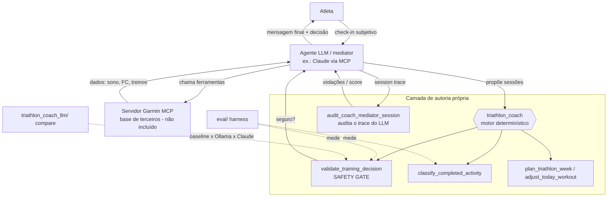

# Triathlon Coach — guardrails determinísticos + avaliação para um agente de treino (LLM)

Camada **neuro-simbólica** para coaching de triatlo: um **motor determinístico** (regras de
ciência do treino) funciona como **guardrail** e **auditor** de um agente LLM que conversa com o
atleta. O LLM decide a mensagem final; o motor **computa, valida, classifica e sinaliza** — e
audita se o agente seguiu o protocolo de segurança. Acompanha um **harness de avaliação** com
datasets rotulados, métricas e comparação de modelos (baseline / Ollama / Claude).

> **Contexto.** Este repositório é a minha camada de autoria própria construída **por cima** do
> servidor open-source [Taxuspt/garmin_mcp](https://github.com/Taxuspt/garmin_mcp) (MIT, ©
> Alexandre Domingues). O servidor-base (110+ ferramentas do Garmin) **não** está incluído aqui —
> veja [`ATTRIBUTION.md`](ATTRIBUTION.md). Aqui a camada roda isolada, offline e testável.

## Por que existe
Agentes LLM são ótimos para conversar, mas não se deve confiar neles para **decisões de segurança**
(prescrever treino forte num dia de fadiga, mandar correr com dor). A ideia é clássica de
*AI Engineering*: **cercar o LLM com uma camada simbólica determinística** que valida cada decisão
e **audita** a sessão do agente — e então **medir** quão bem o LLM concorda com esse oráculo.

## Arquitetura



## Estrutura
```
src/triathlon_coach/      # motor determinístico (autoria própria)
  engine.py               #   safety gate, classificação, planejamento, revisão semanal
  mediator_audit.py       #   auditoria da sessão do agente LLM
  checkin.py, planning.py
eval/                     # avaliação
  dataset/*.jsonl         #   casos rotulados à mão (seguro/inseguro; execução)
  metrics.py              #   precisão/recall/F1/κ/matriz (Python puro)
  run_eval.py             #   roda o motor nos datasets -> results/
  results/                #   relatórios medidos (reprodutíveis)
triathlon_coach_llm/      # camada de IA/LLM
  backends.py             #   Fake (offline), Ollama (local), Claude (API)
  mediator_task.py        #   prompt + parser do veredito
  compare.py              #   compara abordagens na tarefa seguro/inseguro
tests/                    # 117 testes (offline): motor + avaliação + LLM simulado
docs/MODEL_CARD.md        # limitações, viés, privacidade, ética
```

## Como rodar (Windows / PowerShell)
```powershell
# 1. Clonar e entrar na pasta
git clone https://github.com/lucasoalima/TriathlonGarminMCP.git
cd TriathlonGarminMCP

# 2. Ambiente virtual + dependências de dev (o núcleo não tem deps de runtime)
python -m venv .venv
.\.venv\Scripts\Activate.ps1
pip install -r requirements-dev.txt

# 3. Rodar os testes (tudo offline)
python -m pytest -q

# 4. Rodar a avaliação do motor (gera eval/results/)
python eval/run_eval.py

# 5. Comparar abordagens (baseline offline sempre roda)
python -m triathlon_coach_llm.compare
```

Opcional — habilitar os LLMs na comparação:
```powershell
# Claude
$env:ANTHROPIC_API_KEY = "sua-chave"
pip install anthropic
# Ollama (modelo local) — instale https://ollama.com e:
ollama pull llama3.1
# depois:
python -m triathlon_coach_llm.compare
```

## Exemplo de uso (safety gate)
```python
from triathlon_coach.engine import validate_training_decision

res = validate_training_decision(
    proposed_sessions=[{"priority": "primary", "sport": "run",
                        "session_type": "interval", "intensity": "hard", "duration_minutes": 50}],
    day_context={"readiness_level": "low", "sleep_hours": 7.0, "pain_status": "no", "day": "wednesday"},
)
print(res["is_valid"], res["violations"])
# False ['hard_session_with_low_readiness']
```

## Resultados (medidos, não inventados)
Gerados por `python eval/run_eval.py` / `compare.py`. Datasets pequenos e sintéticos → **indicativos**.
Detalhes em [`eval/results/`](eval/results/).

**Safety gate** (`validate_training_decision`, n=24):

| Métrica | Valor |
|---|---|
| Acurácia vs. rótulo humano | 79% |
| Recall de "inseguro" | 75% |
| κ de Cohen (motor vs. humano) | 0.58 |

**Classificação de execução** (campo `status`, n=16): acurácia **94%**, macro-F1 **0.96**, κ **0.91**.

**Baseline vs. motor** (tarefa seguro/inseguro): o baseline heurístico simples atingiu **83%** de
acurácia vs. gold — *acima* do motor (79%) neste conjunto, porque o motor aplica uma regra opinativa
("sem natação no domingo") que gera falsos positivos. Achado honesto, discutido no Model Card.

**Testes:** `python -m pytest -q` → **117 passam, 3 pulam** (os 3 pulados exigem o servidor Garmin
base e são ignorados automaticamente fora dele).

## Limitações, viés, privacidade e ética
Resumo (completo em [`docs/MODEL_CARD.md`](docs/MODEL_CARD.md)):
- `execution_quality` depende de FC; sem FC usamos o campo `status`.
- Regras opinativas (ex.: domingo sem nado) custam acurácia em rótulos gerais.
- Volume alto entra como *warning*, não bloqueio → pode ser permissivo demais.
- Escopo **bem-estar**, não médico. Dado de saúde é sensível (LGPD): nada de token no repo.

## Próximos passos
- Ampliar e diversificar os datasets (mais casos, rotulagem por 2+ avaliadores → κ inter-anotador).
- Rodar Ollama × Claude de verdade e preencher a tabela de comparação.
- *LLM-as-a-judge* para avaliar a **qualidade das explicações** do mediator (hoje avaliamos a decisão).
- RAG sobre diretrizes públicas de treino para fundamentar/citar as decisões.

## Licença
MIT (© 2026 Lucas Soares de Lima) para a camada de autoria própria. Projeto-base de terceiros sob
MIT — ver [`ATTRIBUTION.md`](ATTRIBUTION.md).
